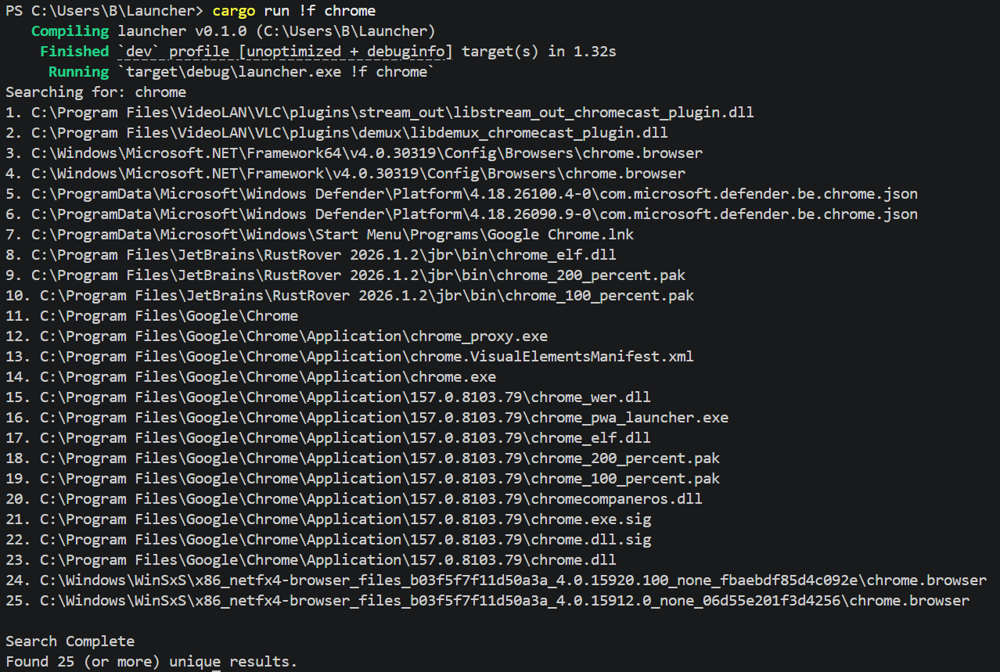

# Launcher
This is a simple command-line Launcher Application created in Rust. It supports features like web search, searching files, and more. I made this because I wanted a light-weight alternative to things like the windows search that I feel are very bloated and just don't have that many good features.

# Running
Navigate to the releases tab in Github and download and run the executable file. Note: you need a windows machine to run the attached executable file and for search to work properly in the application. You can run the application with a different Operating System by cloning the project and compiling it with `cargo run`.

# Operating
The launcher can be run by running the executable through the command line with the query specified after like `launcher.exe !w google.com`
The launcher supports querying wikipedia with `!wiki` prepended, finding files on the computer by prepending `!f`, or prepending `!w` for searching the web (you can also just type something without a prepended keyword and it will treat it as if `!w` was prepended).

If the launcher is not invoked without an query, it will ask the user for an input.

