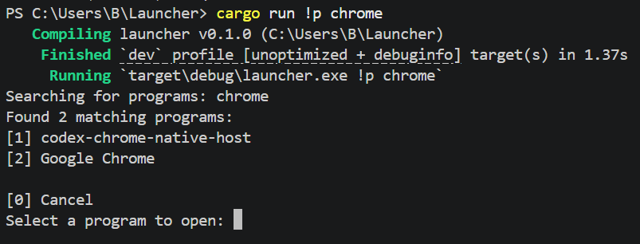

# Launcher
This is a simple command-line Launcher Application created in Rust. It supports web search, file search, program search, and simple calculations. I made this because I wanted a lightweight alternative to things like the windows search that I feel are very bloated and just don't have that many good features.

# Running
Navigate to the releases tab in Github and download and run the executable file. Note: you need to use a windows machine for this application to work properly due to reliance on Win32 API and specific file paths for searching.

# Operating
The launcher can be run by running the executable through the command line with the query specified after like `launcher.exe !w google.com`
The launcher supports querying wikipedia with `!wiki` prepended, finding files on the computer by prepending `!f`, finding programs on the computer by prepending `!p`, prepending `!c` to do calculations (or just typing the calculation normally), or prepending `!w` for searching the web (you can also just type something without a prepended keyword and it will treat it as if `!w` was prepended).

You can run `launcher.exe -h` or `launcher.exe --help` to show a help screen describing full application functionality.

If the launcher is not invoked without an query, it will ask the user for an input.

